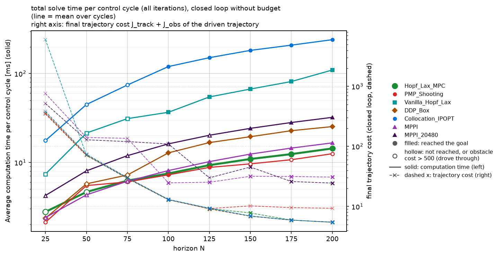

# Hopf-Lax-MPC

Closed-loop comparison of a certified Hopf-Lax quasi-Newton MPC solver (**Hopf_Lax_MPC**, ours)
against PMP shooting (**PMP_Shooting**), **DDP**, direct collocation through CasADi/IPOPT
(**Collocation_IPOPT**), GPU **MPPI** and a vanilla exact-Hessian Hopf-Lax baseline
(**Vanilla_Hopf_Lax**), on a corridor scenario with a symmetric obstacle saddle.

These names are used everywhere in the code: as closed-loop runner names, as `--methods` values of
the sweeps, and in function and parameter names (`hopf_lax_mpc_solve`, `run_hopf_lax_mpc`,
`P.N_hopf_lax_mpc`, `pmp_shooting_solve`, `build_collocation_ipopt`, `vanilla_hopf_lax_solve`, ...).
The two MPPI configurations are `MPPI` (K = 12288) and `MPPI_20480`. Figure and video legends
use the same names.

**Main result** ([section 2](#2-complexity-vs-horizon-n-computation-time-per-cycle-and-trajectory-cost-n_sweep)):
computation time per control cycle and closed-loop trajectory cost of all methods over the horizon
N = 5 ... 200, `N_sweep/figs/N_sweep_time_cost_full.png`; its data is versioned in `N_sweep/data/` and
re-plots in seconds.

## Repository structure

One folder of shared modules and one folder per test. Each test folder holds its scripts, its
`figs/` and its result tables; its results pickles are written there too (not versioned).

```
core/          shared modules (imported by every test)
closed_loop/   1. budgeted closed-loop trajectory outcome (20 ms/cycle), animations
N_sweep/       2. closed-loop complexity and outcome vs horizon N, no budget
multi_agent/   3. multi-agent scaling: K agents as one stacked problem
disturbance/   4. robustness to a bounded process disturbance
```

| folder | file | role |
|---|---|---|
| `core/` | `mpc_core.py` | plant, cost, dynamics, reference path (JAX); verified against the MATLAB reference |
| | `mpc_solvers.py` | all solvers in one module: Hopf_Lax_MPC (`hopf_lax_mpc_solve`, paper Algorithm 1 -- certified Hopf-Lax quasi-Newton) and the baselines it is compared against -- PMP_Shooting (`pmp_shooting_solve`, Levenberg-Marquardt shooting), DDP (and iLQR), Collocation_IPOPT (`build_collocation_ipopt`), MPPI (GPU, CuPy; optional import) and Vanilla_Hopf_Lax (`vanilla_hopf_lax_solve`, exact-Hessian damped Newton, section 2) |
| | `mpc_tuned_params.py` | **all scenario tuning** in one module: `apply_wall_course(P)` (the v6 corridor course: moving wall that stops, lane blocker, closing door, shoulder blocker) and `apply(P)` (the v10 unified-route course: wall course plus a downstream fork with an arriving hot companion, re-calibrated horizons and MPPI pins). Flattened from the former five-module chain `mpc_tuned_params -> _v5 -> _v6 -> _v7 -> _v10`; verified field-for-field identical to what that chain produced |
| `closed_loop/` | `mpc_testbed.py` | closed-loop comparison on the unified-route course under a hard 20 ms/cycle budget (formerly `mpc_testbed_v10.py`). Holds the per-method closed-loop runners and the piecewise obstacle motion; imported by the other tests |
| | `mpc_testbed_newton.py` | the Vanilla_Hopf_Lax runner in the same budgeted testbed (section 2) |
| | `make_animations.py` | 3-D animation renderer; reads a testbed pickle |
| | `snapshot_frame.py` | publication still frames of the animation (PNG/PDF) |
| `N_sweep/` | see section 2 | |
| `multi_agent/` | see section 3 | |
| `disturbance/` | see section 4 | |

Scripts find the shared modules themselves (each adds `../core`, and where needed `../closed_loop`,
to its import path), so no installation step is needed.

## Environment

All dependencies are pinned in `environment.yml` (conda) and `requirements.txt` (pip): Python 3.13,
numpy, scipy, JAX (CPU, shooting methods and DDP), CasADi with bundled IPOPT (collocation),
matplotlib, imageio-ffmpeg (mp4 rendering) and CuPy on CUDA 12.x (GPU MPPI). These are the exact
versions that produced the published results.

Both files work unchanged on **Windows, Linux and macOS**. Only the GPU MPPI baseline is
platform-dependent, and it is handled automatically:

| platform | GPU MPPI (CuPy) | how to run |
|---|---|---|
| Windows / Linux **with** an NVIDIA GPU (CUDA 12.x driver) | installed | all commands as written |
| Windows / Linux **without** an NVIDIA GPU | delete the `cupy-cuda12x` line before creating the environment | add `--no-mppi` |
| macOS (Intel or Apple Silicon) | **skipped automatically** -- no CUDA on Apple hardware, and CuPy publishes no macOS wheel | add `--no-mppi` |

The `cupy-cuda12x` entry carries the environment marker `; platform_system != "Darwin"`, so pip
installs it on Windows/Linux and silently skips it on macOS. macOS users therefore do **not** need to
edit any file -- just create the environment as below. Everything except MPPI is pure CPU and runs
identically on all three platforms.

Create and activate the environment in one go (same on every platform):

```bash
git clone https://github.com/GuanQinG-GitHub/Hopf-Lax-MPC.git
cd Hopf-Lax-MPC
conda env create -f environment.yml
conda activate HopfLaxMPC
```

Check the installation.  With a CUDA GPU (Windows/Linux):

```bash
python -c "import jax, casadi, cupy, imageio_ffmpeg; print('ok', cupy.cuda.runtime.getDeviceCount(), 'GPU(s)')"
```

On macOS, or on any machine without a GPU, leave `cupy` out of the check -- it is not installed
there and importing it will fail:

```bash
python -c "import jax, casadi, imageio_ffmpeg; print('ok', jax.devices())"
```

Pip users can instead run `pip install -r requirements.txt` inside any Python 3.13 environment; the
same marker applies, so that one command is also correct on all three platforms.

Troubleshooting: if the check above fails with `No module named 'cupy'` (or another listed package)
on a machine that should have it, pip found an existing copy in your per-user site-packages and
skipped installing it into the new environment. Set `PYTHONNOUSERSITE=1` before creating the
environment (PowerShell: `$env:PYTHONNOUSERSITE = 1`; bash/zsh: `export PYTHONNOUSERSITE=1`), or
install the missing package into the activated environment with
`pip install --ignore-installed "cupy-cuda12x[ctk]==14.1.1"`.

A second failure mode, seen on macOS: `conda env create` reports that the whole `pip` step failed and
the environment ends up with *no* packages at all. That is the old unconditional `cupy-cuda12x` pin --
conda hands the entire `pip:` list to pip as one install, so a single unresolvable wheel aborts all of
them. The marker above fixes it; if you hit it with an older checkout, just pull and re-create.

Run every command **from inside the test's folder** (`cd closed_loop`, `cd N_sweep`, ...): data and
figure paths are working-directory relative, so pickles, figures and tables land in that folder. The
PowerShell snippets below use `$py` for the interpreter; with the environment activated it is simply:

```powershell
$py = "python"
```

On macOS/Linux, drop the `& $py` prefix and call `python` directly -- e.g.
`python mpc_testbed.py --no-mppi`.

## 1. Closed-loop trajectory outcome (`closed_loop/`)

Run the closed loop, then render (the recorded run is `results_testbed_v10.pkl`, 44 MB, not in the
repository; `mpc_testbed.py` writes `results_testbed.pkl`):

```powershell
cd closed_loop
& $py mpc_testbed.py            # PMP_Shooting, DDP, Collocation_IPOPT, Hopf_Lax_MPC, MPPI, MPPI_20480; 20 ms/cycle budget
& $py mpc_testbed.py --smoke    # 60-cycle pipeline check
& $py mpc_testbed.py --no-mppi  # without a CUDA GPU (always on macOS)

& $py make_animations.py results_testbed_v10.pkl        # combined video + one clip per runner -> figs/
& $py make_animations.py results_testbed_v10.pkl c      # combined video only

& $py mpc_testbed_newton.py --N 55                      # + Vanilla_Hopf_Lax runner -> results_testbed_newton.pkl
& $py make_animations.py results_testbed_newton.pkl c figs/with_newton   # seven-runner video
& $py snapshot_frame.py --t 10                          # still frame -> figs/snapshots/
```

The closed loop runs under a wall-clock budget, so a re-run reproduces the qualitative outcome
(PMP trapped at the wall, DDP trapped at the fork, Hopf-Lax-MPC reaches the goal, MPPI detours) but
not the recorded run bit-for-bit. The committed videos were rendered from the recorded runs
(`results_testbed_v10.pkl`, `results_testbed_newton.pkl`).

## 2. Complexity vs horizon N: computation time per cycle and trajectory cost (`N_sweep/`)



The closed-loop testbed of section 1 runs every method under a hard 20 ms/cycle budget at one tuned
horizon each. This experiment removes the budget and sweeps the horizon instead, N = 5, 10, ..., 200 (40 horizons):
same vehicle, warm starts and stop-at-goal protocol (up to 800 cycles of 20 ms), iteration cap 1000.

**Course: `--scenario wall_saddle_bumps_rand`** (`core/mpc_tuned_params.py`, `NSWEEP_VARIANTS`; the notes
there give the reasons for each choice). Relative to the testbed course: the -y shoulder blocker is moved
to y = -0.9 (its 5 cm gap was a dead-end pocket), the fork post, stage-2 blocker and companion (built for
the budgeted testbed) are moved out, the static z-bump stays offset at (3, 0.25), and seven irregular
static z-bumps are added on the axis before and after the wall (none in x = 6.6 .. 12.2). The wall that
stops on the reference is a near-symmetric saddle: once the horizon is long enough to see around it,
the root-finder PMP_Shooting converges to the on-axis saddle and stays there, while descent methods slide
off. The bumps put the vehicle repeatedly into stiff barrier tails, where Box-DDP's quadratic model fails.

**One shared stopping rule for every iterative method** (`core/shared_stop.py`, `--shared-stop 1e-6`).
At every iteration the method's current control sequence U is scored with the SAME horizon cost
J_ocp(U) (zero-order-hold RK4 rollout, tracking + control + barrier costs, terminal cost -- DDP's
`rollout_cost`), and the solve stops when |J_k - J_{k-1}| <= 1e-6 |J_k| + 1e-10 on consecutive accepted
iterates. It replaces each method's own tolerance (IPOPT's own convergence test is pushed out of reach);
each method keeps its failure exits (no accepted step, damping cap, iteration cap), and Hopf_Lax_MPC
keeps its saddle guard (it stops only on a convex curvature read). The rule's evaluation is not timed.
MPPI keeps its protocol of one sampling update per cycle.

**DDP baseline: Box-DDP** (`DDP_Box`, control-limited DDP after Tassa, Mansard & Todorov 2014): the
per-stage step is a box QP (projected Newton) and the feedback of clamped controls is zero; the EXACT
barrier Hessian is used (no PSD projection), so near the stiff barriers Quu can be indefinite, the
Cholesky fails and the damping grows; a cycle ends at the damping cap mu > 1e10 (`mu-max`). The +y
nudge of the testbed's DDP warm start is not applied in the sweep.

Reading the figure: solid lines (left, log) = mean solver time per control cycle (all iterations of a
cycle; cycle 1 and recompile cycles excluded); dashed x (right, log) = final closed-loop trajectory
cost J_track + J_obs of the driven trajectory with the true obstacle motion; filled markers = reached
the goal without driving through an obstacle (obstacle cost <= 500), hollow = not reached or drove
through. A trapped run keeps accumulating cost for the full 16 s, a reached one stops at the goal. Timing:
one method per process, one at a time, on an otherwise idle machine (16 logical cores); a CPU monitor
logged every process every 5 s -- foreign load averaged 0.1 - 1.2 % of the machine per method, the one
burst (a Defender scan, ~2 cores for 1 min) overlapped MPPI_20480 N = 125 - 140 and left no visible step.

| method | ms per cycle, N = 5 -> 100 -> 200 | reaches the goal (no drive-through) | trajectory cost, N = 100 / 125 / 150 / 175 / 200 |
|---|---|---|---|
| Hopf_Lax_MPC | 1.0 -> 7.3 -> 14.9 | every N >= 100 | 12.9 / 9.2 / 7.8 / 5.9 / **5.45** |
| PMP_Shooting | 0.7 -> 7.1 -> 12.5 | N = 100 - 125, 135, 145; trapped at the wall saddle otherwise | 12.9 / 9.2 / 10.2 / 9.5 / 9.3 |
| DDP_Box | 1.6 -> 13.5 -> 26.7 (1.8 - 2.05x ours for N >= 100) | every N >= 100 | 13.0 / 9.1 / 6.9 / 5.9 / 5.47 |
| Collocation_IPOPT | 3.8 -> 119 -> 246 (16 - 18x ours) | every N >= 100 | 13.1 / 9.3 / 6.9 / 5.9 / 5.45 |
| Vanilla_Hopf_Lax | 2.8 -> 41 -> 112 (5.6 - 7.6x ours) | every N >= 100 (N = 15 too, but with obstacle cost 309) | 12.9 / 9.2 / 6.9 / 5.9 / 5.45 |
| MPPI (K = 12288) | 0.9 -> 8.1 -> 16.6 | N = 100, 115, every N >= 125 | 24.7 / 25.3 / 31.7 / 31.5 / 30.7 |
| MPPI (K = 20480) | 1.3 -> 16.1 -> 31.9 | N = 115, 120, 130, 135, every N >= 145 | 110 (trapped) / 29.9 (trapped) / 45.3 / 26.0 / 24.4 |

For N <= 20 the lookahead (<= 0.1 s) is too short to avoid the obstacles: the methods drive through them
(obstacle cost > 500, hollow markers; Vanilla_Hopf_Lax at N = 15 gets through with 309). For N = 25 - 95
the lookahead is too short to get around the wall and every method ends in front of it (costs coincide;
Vanilla_Hopf_Lax at N = 20 - 40 instead leaves the course, tracking cost up to 1.7e4). From N = 100 the descent methods reach the goal with near-identical costs; from
N = 130 PMP_Shooting is caught on the saddle (alternating at 130 - 145, always from 150) while
Hopf_Lax_MPC escapes it (curvature kick). At N = 150 Hopf_Lax_MPC goes around the +y side (7.8) while
DDP_Box / collocation / vanilla go -y (6.9); from N = 155 on they agree.

**MPPI baseline: vanilla MPPI / IT-MPC** (Williams et al. 2018, Alg. 2; `run_mppi`): fixed temperature
lambda = 0.01 (`--mppi-lambda`), fixed Sigma (sigma = 0.3 x control range), gamma = lambda (1 - alpha),
1 % zero-mean samples, one importance-weighted update per cycle + Savitzky-Golay smoothing, warm start by
shifting; the sample cost is the shared OCP cost plus the IT-MPC term gamma u' Sigma^-1 v. (The 20 ms
testbed's per-cycle re-tuning of lambda to 5 % ESS is not used here: it makes the effective control
weight lambda / (2 sigma^2 dt) drift by ~20 - 80x the OCP's R from cycle to cycle.) lambda was calibrated
once on this course (closed loop, N = 100 / 150 / 200, seeds 0 - 2): 0.01 reached in 7/9 runs, 0.03 in
3/9; lambda <= 0.003 collapses the weights onto one sample, lambda >= 0.1 averages almost uniformly and
drifts. MPPI never enters an obstacle, but it skims every barrier: at rho ~ 1.09 - 1.15 per z-bump
(ours / DDP ~ 1.3), so its obstacle cost (15 - 23) is 10 - 25x ours. With a fixed lambda the ESS falls
with the horizon (12288 samples: ~2300 at N = 25, ~70 at N = 100, ~1 at N = 200, as the cost spread grows),
so at long horizons the update is essentially the single best sample, while 8 - 24 % of the samples enter
an obstacle (logged per cycle as `extra['hit']`, the weight they carry as `extra['whit']`).

| file | role |
|---|---|
| `mpc_testbed_N_sweep.py` | sweep driver (instrumented copies of the testbed runners; per cycle: solve time, iterations, status, residual, method counters); `--methods`, `--Ns`, `--shared-stop EPS`, `--scenario`, `--selftest`; results merge into `results_N_sweep_shared_eps1e-06_<scenario>.pkl` (not versioned), saved after every (method, N) run |
| `plot_cycle_band.py` | the figure above (`--data` or `--pkl`; `--overlay-cost`, `--mark-reached`, `--Nmax`, `--exclude`; optional +-3 sigma band) |
| `data/N_sweep_plot_data.npz` | **versioned data of the figure** (2.4 MB): per (method, N) the per-cycle solve times, cycle count, recompile flags, reached, J_obs, J_true, J_track -- extracted from the 38 MB sweep pickle by `export_plot_data.py` (round trip checked exactly; the figure re-renders pixel-identical) |
| `data/N_sweep_summary.csv` | the plotted numbers as a table: mean / std ms per cycle, reached, drove through, J_true, J_track, J_obs, cycles, run time stamp |
| `make_animation_sweep.py` | 3-D animation of all methods at one horizon N from the sweep data |
| `run_grid.sh`, `cpu_monitor.ps1` | the full-grid driver (idle gate, one method per process) and the per-process CPU logger |
| `backup_data/` | earlier local runs (testbed course v10, the layout trials open_shoulder ... wall_saddle_ridge, ESS-tuned MPPI, original stopping rules), not versioned |

Re-plot the figure from the versioned data (seconds, no GPU / solver needed):

```powershell
cd N_sweep
& $py plot_cycle_band.py --data data/N_sweep_plot_data.npz --log --no-band --mark-reached --overlay-cost `
      --Nmax 200 --out figs/N_sweep_time_cost_full.png
```

Regenerate the data (about 2 h 45 min on the reference machine; run ONE timing job at a time -- parallel load
distorts the per-cycle times):

```powershell
cd N_sweep
& $py mpc_testbed_N_sweep.py --selftest
# one method per process, one at a time, each started only on an idle machine (< 10 % CPU), with a
# per-process CPU log in sweep_logs/cpu_log.csv (start cpu_monitor.ps1 first, stop it afterwards):
Start-Process powershell -ArgumentList "-File cpu_monitor.ps1" -WindowStyle Hidden
bash run_grid.sh     # N = 5..200 step 5, all 7 methods -> results_N_sweep_shared_eps1e-06_wall_saddle_bumps_rand.pkl
& $py export_plot_data.py      # pickle -> data/N_sweep_plot_data.npz + data/N_sweep_summary.csv
& $py plot_cycle_band.py --data data/N_sweep_plot_data.npz --log --no-band --mark-reached --overlay-cost `
      --Nmax 200 --out figs/N_sweep_time_cost_full.png
```

## 3. Multi-agent scaling: K decoupled agents as one stacked problem (`multi_agent/`)


How does Hopf-Lax-MPC's computation scale with the number of vehicles when K identical agents are
solved as ONE stacked problem? The agents are fully decoupled (no inter-agent cost, no coupling in
the dynamics); only the problem is stacked: costate [p_1; ...; p_K] (7K), state [x_1; ...; x_K],
residual [rho_1; ...; rho_K], objective sum_k Phi_k. The algorithm is unchanged: `hopf_lax_mpc_solve` runs on a
stacked shooting object that has the same API as the single-agent one, with the Jacobians formed by
the same fused forward-mode pass over the full 7K-dimensional costate (no exploitation of the
block-diagonal structure). Scene: all moving obstacles frozen at their t = 0 positions; agent k spawns
at (0, y_k) and its goal is the opposite corner (20, -y_k), y_k spread over [-2, 2]; the RRT planner
sees the static obstacle plus the frozen bodies, so each reference is a feasible route. Protocol:
N = 220, no budget, iteration cap 1000, closed loop until every agent is at its goal (each agent's cost
is accumulated up to its own arrival).

| file | role |
|---|---|
| `mpc_multi.py` | frozen scene, per-agent start / goal / reference, stacked shooting object (`build_ss_multi`), per-agent true-cost step |
| `mpc_testbed_multi.py` | the sweep driver (`--K 1,2,...`), `--selftest`, `--solo k` (one agent of the K-layout alone), results merged per K into `results_multi.pkl` (not versioned) |
| `make_animation_multi.py` | top-down real-time animation of one K (trails, predicted horizons re-rolled from the stored costates, HUD); `--three-d` gives the 3-D view in the style of `make_animations.py`: `figs/multi/K10/anim.mp4` and `figs/multi/K10/anim3d.mp4` for the 10-agent run |
| `plot_multi.py` | `figs/multi/K<K>/paths.png`, `figs/multi/K<K>/review.png` (paths + y, speed, heading, control, goal distance, solver per cycle), `figs/multi/scaling.png`, and the table `results_multi_table.txt` |

Correctness: with K = 1 the stacked object reproduces `mpc_core.build_ss` to round-off and the solver
returns a bitwise-identical costate; with K = 2 the stacked Jacobians are exactly block-diagonal, the
converged stacked costate equals the two solo solves to 2e-9, and in closed loop each agent's controls
match its solo run to 2.6e-5 with identical cost. Timing was measured on an idle machine (a first pass
with another job running inflated K = 6 to 8 by 20 to 30 percent and was discarded).

What the sweep shows (K = 1 to 10, stacked dimension 7 to 70, every run converged in every cycle and
every agent reached its goal):

- **Per-iteration cost grows between linearly and quadratically in K**: 5.4, 9.7, 14.6, 21.4, 28.5 ms
  for K = 1 to 5, then 58, 72, 91, 112, 176 ms for K = 6 to 10. The iteration count is almost flat
  (2.2 to 2.9 per cycle), so the solve time per cycle follows the same curve (12 ms to 490 ms).
- **The step between K = 5 and K = 6 (2.0x instead of about 1.3x) is a kernel regime change, not the
  algorithm.** It sits entirely in the fused Jacobian pass `S.all`, which batches 7K tangent
  directions times K agents = 7K^2 rollouts in one XLA kernel; the single rollout, the batched line
  search and the dense 7K x 7K algebra all grow smoothly. Varying the number of tangent directions
  independently of K reproduces the step whenever the batch exceeds about 200 rollouts (K = 4: between
  42 and 49 tangents, K = 5: between 35 and 42, K = 6: between 28 and 35, K = 7: between 21 and 28),
  and 7K^2 crosses 200 exactly between K = 5 (175) and K = 6 (252).
- **Where the time goes.** The dense linear algebra on the 7K x 7K surrogate (eigendecomposition,
  solve) is below 0.1 ms even at K = 8; the cost is the rollouts. The quadratic term comes from
  forming a full 7K x 7K Jacobian of a block-diagonal problem: exploiting the structure (per-agent
  Jacobians, 7 tangents each) would make the pass linear in K, which is the obvious next step for a
  real multi-vehicle deployment.

```powershell
cd multi_agent
& $py mpc_testbed_multi.py --selftest            # K=1 bitwise vs single agent; K=2 block equality vs solo solves
& $py mpc_testbed_multi.py --K 1,2,3,4,5,6,7,8,9,10   # sweep -> results_multi.pkl
& $py plot_multi.py                              # -> figs/multi/... + results_multi_table.txt
& $py make_animation_multi.py --K 10             # -> figs/multi/K10/anim.mp4 (--three-d -> anim3d.mp4)
```

## 4. Robustness to a bounded process disturbance (`disturbance/`)


The budgeted Hopf-Lax-MPC runner of section 1 (N = 220, 20 ms/cycle) on the same course, but the
simulated plant is `xdot = f(x, u) + d`, with `d` a clipped Gaussian redrawn at every 5 ms simulation
step: per axis `|d_i| <= b * s_i`, `sigma_i = 0.5 * b * s_i`. The per-axis scale `s` (`--scale
practical`) puts a bound of 5 cm/s and 3 deg/s on the kinematic drift and 10 percent of the actuator
authority on the force and torque channels at b = 1. The controller does not know about `d`; it
predicts with the clean model. The fork post sits at y = -0.1 (`--post-y -0.1`), and the recorded
sweep is b = 0..30 with five seeds (0, 2, 4, 6, 11). Every run reaches the goal up to b = 9; beyond
that, failures (and obstacle-shell entries) appear at some seeds, see `results_disturb_table.txt`.

| file | role |
|---|---|
| `mpc_testbed_disturb.py` | closed-loop runs keyed by (scale, post_y, bound, seed), merged into a results pickle; `--table` prints the comparison table (with the recorded clean run from `../closed_loop/results_testbed_v10.pkl` when present) |
| `plot_disturb.py` | cost / completion-rate figure versus b and the per-b table `results_disturb_table.txt` |
| `make_animations_disturb.py` | 3-D animation of one run with per-tick arrows for f(x,u) (blue) and d (red) |
| `snapshot_disturb.py` | publication still frames of one run (PNG/PDF) |

```powershell
cd disturbance
$bs = (0..30) -join ","                                    # b = 0,1,...,30
& $py mpc_testbed_disturb.py --post-y -0.1 --bound $bs --seeds 0,2,4,6,11 --out results_disturb_posty-0.1.pkl
& $py plot_disturb.py --seeds 0,2,4,6,11 --out figs/disturb/disturb_sweep_v2.png   # prints the per-b table
& $py make_animations_disturb.py --bound 30 --seed 0 --post-y -0.1 --out figs/disturb/anim_b30_seed0_success.mp4
& $py snapshot_disturb.py --pkl results_disturb_viz.pkl --bound 30 --seed 6 --t 6,9
```
