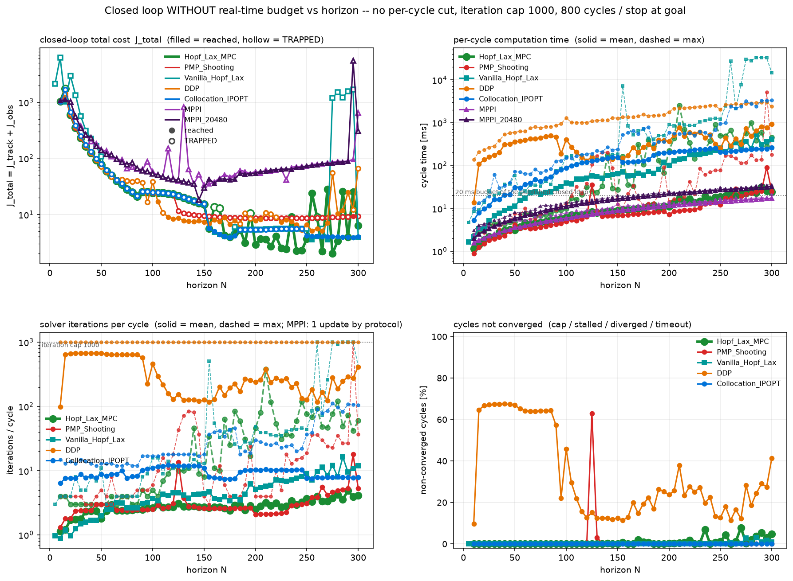
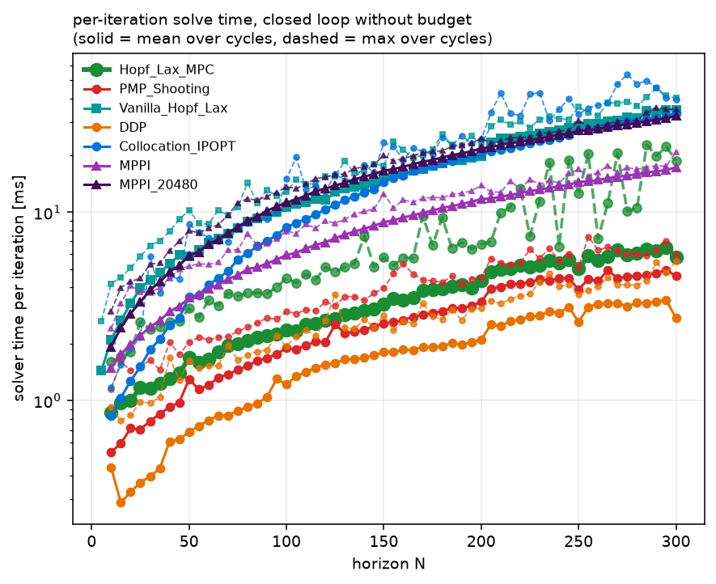
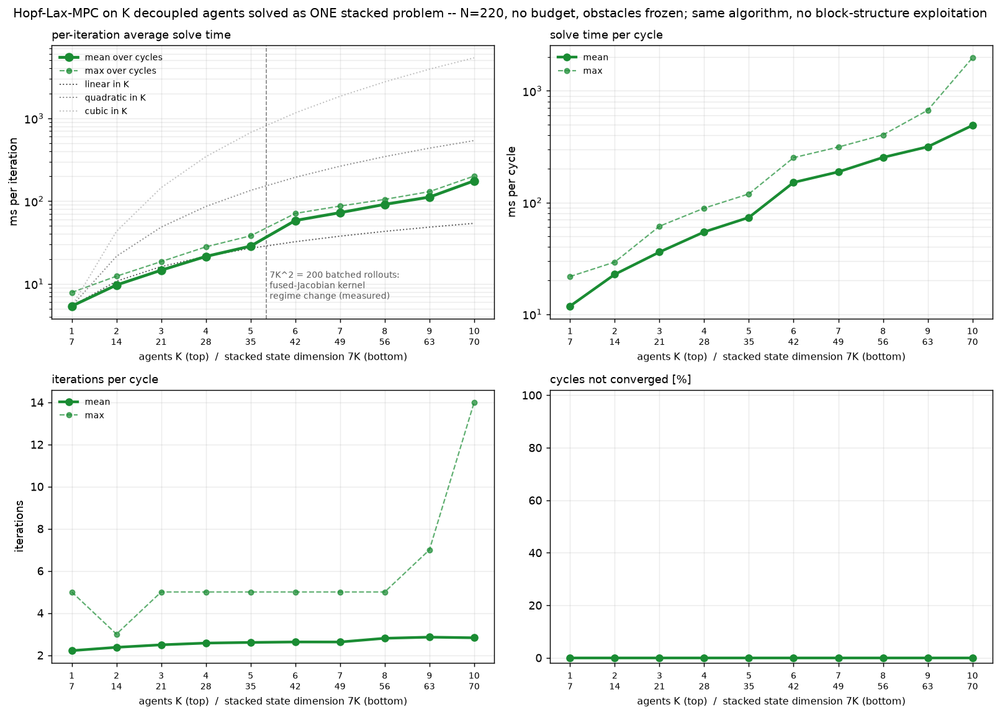
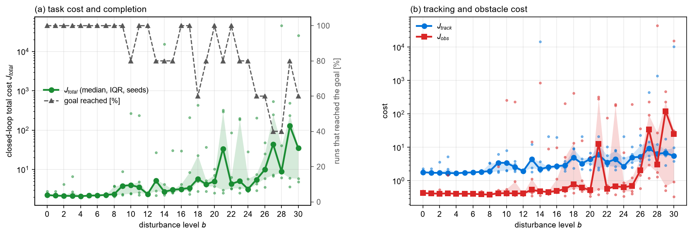

# Hopf-Lax-MPC

Closed-loop comparison of a certified Hopf-Lax quasi-Newton MPC solver (**Hopf_Lax_MPC**, ours)
against PMP shooting (**PMP_Shooting**), **DDP**, direct collocation through CasADi/IPOPT
(**Collocation_IPOPT**), GPU **MPPI** and a vanilla exact-Hessian Hopf-Lax baseline
(**Vanilla_Hopf_Lax**), on a corridor scenario with a symmetric obstacle saddle.

These names are used everywhere in the code: as closed-loop runner names, as `--methods` values of
the sweeps, and in function and parameter names (`hopf_lax_mpc_solve`, `run_hopf_lax_mpc`,
`P.N_hopf_lax_mpc`, `pmp_shooting_solve`, `build_collocation_ipopt`, `vanilla_hopf_lax_solve`, ...).
The two MPPI configurations are `MPPI` (K = 12288) and `MPPI_20480`. Figure and video legends
use the same names.

## Repository structure

One folder of shared modules and one folder per test. Each test folder holds its scripts, its
`figs/` and its result tables; its results pickles are written there too (not versioned).

```
core/          shared modules (imported by every test)
closed_loop/   1. budgeted closed-loop trajectory outcome (20 ms/cycle), animations
N_sweep/       2. closed-loop complexity and outcome vs horizon N, no budget
multi_agent/   3. multi-agent scaling: K agents as one stacked problem
disturbance/   4. robustness to a bounded process disturbance
```

| folder | file | role |
|---|---|---|
| `core/` | `mpc_core.py` | plant, cost, dynamics, reference path (JAX); verified against the MATLAB reference |
| | `mpc_solvers.py` | all solvers in one module: Hopf_Lax_MPC (`hopf_lax_mpc_solve`, paper Algorithm 1 -- certified Hopf-Lax quasi-Newton) and the baselines it is compared against -- PMP_Shooting (`pmp_shooting_solve`, Levenberg-Marquardt shooting), DDP (and iLQR), Collocation_IPOPT (`build_collocation_ipopt`), MPPI (GPU, CuPy; optional import) and Vanilla_Hopf_Lax (`vanilla_hopf_lax_solve`, exact-Hessian damped Newton, section 2) |
| | `mpc_tuned_params.py` | **all scenario tuning** in one module: `apply_wall_course(P)` (the v6 corridor course: moving wall that stops, lane blocker, closing door, shoulder blocker) and `apply(P)` (the v10 unified-route course: wall course plus a downstream fork with an arriving hot companion, re-calibrated horizons and MPPI pins). Flattened from the former five-module chain `mpc_tuned_params -> _v5 -> _v6 -> _v7 -> _v10`; verified field-for-field identical to what that chain produced |
| `closed_loop/` | `mpc_testbed.py` | closed-loop comparison on the unified-route course under a hard 20 ms/cycle budget (formerly `mpc_testbed_v10.py`). Holds the per-method closed-loop runners and the piecewise obstacle motion; imported by the other tests |
| | `mpc_testbed_newton.py` | the Vanilla_Hopf_Lax runner in the same budgeted testbed (section 2) |
| | `make_animations.py` | 3-D animation renderer; reads a testbed pickle |
| | `snapshot_frame.py` | publication still frames of the animation (PNG/PDF) |
| `N_sweep/` | see section 2 | |
| `multi_agent/` | see section 3 | |
| `disturbance/` | see section 4 | |

Scripts find the shared modules themselves (each adds `../core`, and where needed `../closed_loop`,
to its import path), so no installation step is needed.

## Environment

All dependencies are pinned in `environment.yml` (conda) and `requirements.txt` (pip): Python 3.13,
numpy, scipy, JAX (CPU, shooting methods and DDP), CasADi with bundled IPOPT (collocation),
matplotlib, imageio-ffmpeg (mp4 rendering) and CuPy on CUDA 12.x (GPU MPPI). These are the exact
versions that produced the published results.

Both files work unchanged on **Windows, Linux and macOS**. Only the GPU MPPI baseline is
platform-dependent, and it is handled automatically:

| platform | GPU MPPI (CuPy) | how to run |
|---|---|---|
| Windows / Linux **with** an NVIDIA GPU (CUDA 12.x driver) | installed | all commands as written |
| Windows / Linux **without** an NVIDIA GPU | delete the `cupy-cuda12x` line before creating the environment | add `--no-mppi` |
| macOS (Intel or Apple Silicon) | **skipped automatically** -- no CUDA on Apple hardware, and CuPy publishes no macOS wheel | add `--no-mppi` |

The `cupy-cuda12x` entry carries the environment marker `; platform_system != "Darwin"`, so pip
installs it on Windows/Linux and silently skips it on macOS. macOS users therefore do **not** need to
edit any file -- just create the environment as below. Everything except MPPI is pure CPU and runs
identically on all three platforms.

Create and activate the environment in one go (same on every platform):

```bash
git clone https://github.com/GuanQinG-GitHub/Hopf-Lax-MPC.git
cd Hopf-Lax-MPC
conda env create -f environment.yml
conda activate HopfLaxMPC
```

Check the installation.  With a CUDA GPU (Windows/Linux):

```bash
python -c "import jax, casadi, cupy, imageio_ffmpeg; print('ok', cupy.cuda.runtime.getDeviceCount(), 'GPU(s)')"
```

On macOS, or on any machine without a GPU, leave `cupy` out of the check -- it is not installed
there and importing it will fail:

```bash
python -c "import jax, casadi, imageio_ffmpeg; print('ok', jax.devices())"
```

Pip users can instead run `pip install -r requirements.txt` inside any Python 3.13 environment; the
same marker applies, so that one command is also correct on all three platforms.

Troubleshooting: if the check above fails with `No module named 'cupy'` (or another listed package)
on a machine that should have it, pip found an existing copy in your per-user site-packages and
skipped installing it into the new environment. Set `PYTHONNOUSERSITE=1` before creating the
environment (PowerShell: `$env:PYTHONNOUSERSITE = 1`; bash/zsh: `export PYTHONNOUSERSITE=1`), or
install the missing package into the activated environment with
`pip install --ignore-installed "cupy-cuda12x[ctk]==14.1.1"`.

A second failure mode, seen on macOS: `conda env create` reports that the whole `pip` step failed and
the environment ends up with *no* packages at all. That is the old unconditional `cupy-cuda12x` pin --
conda hands the entire `pip:` list to pip as one install, so a single unresolvable wheel aborts all of
them. The marker above fixes it; if you hit it with an older checkout, just pull and re-create.

Run every command **from inside the test's folder** (`cd closed_loop`, `cd N_sweep`, ...): data and
figure paths are working-directory relative, so pickles, figures and tables land in that folder. The
PowerShell snippets below use `$py` for the interpreter; with the environment activated it is simply:

```powershell
$py = "python"
```

On macOS/Linux, drop the `& $py` prefix and call `python` directly -- e.g.
`python mpc_testbed.py --no-mppi`.

## 1. Closed-loop trajectory outcome (`closed_loop/`)

Run the closed loop, then render (the recorded run is `results_testbed_v10.pkl`, 44 MB, not in the
repository; `mpc_testbed.py` writes `results_testbed.pkl`):

```powershell
cd closed_loop
& $py mpc_testbed.py            # PMP_Shooting, DDP, Collocation_IPOPT, Hopf_Lax_MPC, MPPI, MPPI_20480; 20 ms/cycle budget
& $py mpc_testbed.py --smoke    # 60-cycle pipeline check
& $py mpc_testbed.py --no-mppi  # without a CUDA GPU (always on macOS)

& $py make_animations.py results_testbed_v10.pkl        # combined video + one clip per runner -> figs/
& $py make_animations.py results_testbed_v10.pkl c      # combined video only

& $py mpc_testbed_newton.py --N 55                      # + Vanilla_Hopf_Lax runner -> results_testbed_newton.pkl
& $py make_animations.py results_testbed_newton.pkl c figs/with_newton   # seven-runner video
& $py snapshot_frame.py --t 10                          # still frame -> figs/snapshots/
```

The closed loop runs under a wall-clock budget, so a re-run reproduces the qualitative outcome
(PMP trapped at the wall, DDP trapped at the fork, Hopf-Lax-MPC reaches the goal, MPPI detours) but
not the recorded run bit-for-bit. The committed videos were rendered from the recorded runs
(`results_testbed_v10.pkl`, `results_testbed_newton.pkl`).

## 2. Closed loop without a real-time budget vs horizon (`N_sweep/`)



The closed-loop testbed of section 1 runs every method under a hard 20 ms/cycle budget at one tuned
horizon each. This experiment removes the budget and sweeps the horizon instead: same scenario,
obstacles, warm starts and stop-at-goal protocol, but every solver runs to convergence or to an
iteration cap of 1000 (`lm_maxit`, `ilqr_Kmax`, IPOPT `max_iter`), and N is swept densely from
10 to 300 in steps of 5 (59 horizons) for all six runners (the Newton baseline from 50 to 300). MPPI keeps its
published protocol of one sampling update per cycle (there is no iteration loop to unbudget), at
K = 12288 and K = 20480.

| file | role |
|---|---|
| `mpc_testbed_N_sweep.py` | sweep driver with instrumented copies of the five testbed runners (the originals discard iteration counts); records per cycle the solve time, iteration count, termination status, final residual and method-specific counters; merges into `results_N_sweep.pkl`, saved after every (method, N) run so it can be interrupted and resumed |
| `plot_N_sweep.py` | the 2 x 2 figure above and a per-(method, N) table |
| `../closed_loop/mpc_testbed_newton.py` | the Vanilla_Hopf_Lax baseline in the **budgeted** testbed (hard 20 ms cut, viz logging) at N = 55, appended to the recorded six-runner pickle for the seven-runner animation `closed_loop/figs/with_newton/anim_all_methods.mp4` |
| `../core/mpc_solvers.py` (`vanilla_hopf_lax_solve`) | the **Vanilla_Hopf_Lax** (Newton, exact Hessian) baseline: damped Newton on the Hopf-Lax objective with `jax.hessian`, Levenberg damping (H + mu I), batched Armijo line search, gradient-only stopping test; no curvature certificate, no saddle escape. Run with `--methods Vanilla_Hopf_Lax` (not in the default list); `--vanilla-hopf-lax-tol` (1e-4 used), `--hess-mode` |
| `results_N_sweep_table.txt` | the per-(method, N) table printed by `plot_N_sweep.py` for the recorded sweep (405 runs, Oct 7-8 2026: 36 sparse runs in 1 h 10 min, 210 dense runs in 4 h 40 min, 31 Newton runs N = 50..200 in 32 min, 128 runs for N = 205..300 in 5 h 30 min) |
| `results_N_sweep.pkl` | the recorded per-cycle data behind the figures (55 MB, **not in the repository**; regenerate with the commands below, or ask the authors) |

```powershell
cd N_sweep
& $py mpc_testbed_N_sweep.py --selftest       # counted solver copies == originals, bitwise
& $py mpc_testbed_N_sweep.py --smoke           # 60-cycle pipeline check -> results_N_sweep_smoke.pkl
& $py mpc_testbed_N_sweep.py                   # sparse sweep N=50..300 (resumable; --methods, --Ns, --redo, --cap)
$Ns = ((2..60 | ForEach-Object { $_ * 5 }) -join ",")                       # 10,15,...,300
& $py mpc_testbed_N_sweep.py --methods PMP_Shooting,Hopf_Lax_MPC,MPPI,MPPI_20480,Collocation_IPOPT,DDP --Ns $Ns   # dense sweep, ~10 h
& $py mpc_testbed_N_sweep.py --methods Vanilla_Hopf_Lax --Ns $Ns --vanilla-hopf-lax-tol 1e-4   # Vanilla_Hopf_Lax, ~2 h
& $py plot_N_sweep.py                          # -> figs/N_sweep_*.png + table (results_N_sweep_table.txt)
& $py plot_periter_band.py                     # -> figs/N300_sweep/N_sweep_periter_mean_band.png/.pdf
```

Statuses per cycle: `converged`, `acceptable` (IPOPT), `cap` (hit 1000 iterations while still
accepting steps), `stalled` (no accepted step for 50+ iterations, i.e. a damping crawl into the cap,
or a failed line search), `esc-stalled` (Hopf-Lax-MPC escape without an improving step), `diverged`,
`timeout` (only with `--cycle-timeout`). Timing statistics exclude cycle 1 and recompile-tagged cycles.

What the recorded sweep shows (panel by panel):

- **Cost.** Three regimes. Up to N ≈ 150 (0.75 s, about 1 m of lookahead) every method is trapped at
  the wall and the cost falls monotonically with N for all of them, identically for the four
  deterministic solvers. At N = 10 and 15 the horizon is so short that the controllers drive straight
  through the obstacles along the reference and "reach" the goal with an obstacle cost near 1000.
  From N = 155 the methods start to get around the wall, and between 155 and 200 the outcome flips
  between reached and trapped from one horizon to the next: Hopf-Lax-MPC reaches at 155, 170 to 180,
  190, 200 and above; collocation at 155 to 180, then is trapped at 185 to 200 and reaches again at
  250 and 300; DDP at 105 and 115 to 180, then 200 and 250; MPPI at 155 to 250 but with an order of
  magnitude more obstacle cost. PMP is trapped at every horizon. The flips happen for collocation
  too, which converges in every cycle, so in this band they are a property of the receding-horizon
  problem (frozen-obstacle prediction, the fork and the arriving companion, a non-convex route
  choice), not of a solver. Best closed-loop cost: Hopf-Lax-MPC 2.0 at N = 275, collocation 3.9
  at N = 295, DDP 5.1 at N = 265, PMP 8.6, MPPI 18 to 33.
- **N = 205 to 300.** Hopf-Lax-MPC reaches the goal at 19 of the 20 horizons (trapped only at 260)
  and holds the lowest cost of all methods, 2.0 to 4.1 at most horizons, but at five horizons (235,
  255, 270, 285, 295) it reaches with a cost of 9 to 28: those runs contain the stalled-cycle
  episodes at the fork diagnosed below (up to 8 percent of cycles), which push it onto the wide
  route. Collocation reaches from N = 250 on with a flat 3.9 to 4.1. DDP reaches at 14 of 20
  horizons with 5 to 10 and is trapped at 300. PMP stays trapped except at N = 295. MPPI reaches at
  18 of 20 but with costs of 40 to 100, and collapses at N = 295 to 300 (K = 20480 at 295: 5476).
  The Newton baseline reaches at 255, 260, 270 and 300 (3.5 to 5.6) but blows up at N = 275 to 295
  (cost 1200 to 1700, cycle time up to 0.5 s): the exact Hessian becomes strongly indefinite
  (smallest eigenvalue -2.4) and the damping is raised more than 6000 times per run, the
  sensitivity of inverting the exact Hessian at long horizons in its purest form.
- **Time.** Without a budget, Hopf-Lax-MPC and PMP stay at or below the 20 ms line on average up to
  N = 300 (1 to 25 ms, growing with N); collocation costs 5 to 260 ms per cycle; DDP costs 100 to
  900 ms per cycle on average with worst cycles above 2 s, except at N = 10.
- **Iterations.** Hopf-Lax-MPC and PMP need 1 to 5 iterations per cycle on average over the whole
  grid, collocation 6 to 18 (up to 40 in the band where it threads the fork). DDP averages 130 to
  700 and hits the cap at every horizon above 10.
- **Non-convergence.** DDP fails to converge in 10 to 67 percent of cycles (damping crawls at the
  stiff barriers; worst below N = 90). PMP has one isolated spike (63 percent at N = 125, where it
  first starts to feel the wall's saddle). Hopf-Lax-MPC has at most 2 percent of stalled cycles up to
  N = 250 and 5 percent at N = 300; collocation and the Newton baseline converge in every cycle.

**Vanilla_Hopf_Lax: Newton with the exact Hessian** (`vanilla_hopf_lax_solve` in `mpc_solvers.py`, swept for N = 50 to 200). This baseline minimises
the same Hopf-Lax objective as Hopf-Lax-MPC but with the exact second derivative from `jax.hessian`
instead of the surrogate, damped Newton steps and a line search, and stops on the gradient alone.
Its correctness was checked before the sweep: the exact Hessian matches central finite differences of
the gradient to 1e-11 and agrees with the surrogate to 3e-9 at certified points; from Hopf-Lax-MPC's
warm start it converges in at most one iteration to the same costate; and in closed loop at N = 100
its controls match Hopf-Lax-MPC and PMP to 1e-3 until the wall. A looser tolerance (1e-3) was tried
first and rejected: at long horizons the small curvature turns a 1e-3 gradient into a 0.05 control
error from t = 0.5 s on and flips the N = 155 outcome, so the sweep uses the same 1e-4 certificate as
Hopf-Lax-MPC. What the sweep shows:

- **It behaves like a local minimiser of the same problem, i.e. like collocation.** Trapped at the
  wall for N <= 150 with costs identical to Hopf-Lax-MPC to three digits; reaches the goal at
  N = 155 to 175 (collocation: 155 to 180); trapped at the fork at N = 180 to 200 with the same cost
  as collocation (5.36 to 5.39). Hopf-Lax-MPC differs exactly where its escape fires: it reaches at
  N = 190 and 200 (2.9 to 3.1) where Newton and collocation are stuck at the fork.
- **The exact Hessian costs 3 to 4 times more per iteration**: 6 to 20 ms per iteration versus
  1.7 to 4.3 ms for Hopf-Lax-MPC at the same N, with the Hessian itself 70 percent of the solve time,
  and 2 to 6 iterations per cycle instead of 2 to 3. Per cycle that is 11 to 120 ms, above the 20 ms
  budget from N = 70 on.
- **Sensitivity shows up as iteration spikes, not failures**: 100 percent converged at every horizon,
  but single cycles need up to 503 iterations (N = 155) and the damping has to be raised 1400 to 4500
  times per run at N >= 155 because the exact Hessian is indefinite near the wall.
- **Newton in the 20 ms budgeted testbed (`mpc_testbed_newton.py`).** The horizon was chosen with
  the same rule as Hopf-Lax-MPC's N = 220: the largest horizon whose p99 cycle time stays inside the
  budget. Budgeted Newton runs at N = 40 to 200 (`--cycle-timeout 0.02`): the cut can only act between
  iterations, and one exact-Hessian iteration already costs 5 ms at N = 50 and 16 ms at N = 170, so the
  mean cycle time crosses 20 ms at N = 60 to 70 and reaches 27 to 35 ms (1.4 to 1.75 times the budget)
  at the horizons where Newton would reach the goal (N >= 170, with one iteration per cycle). Within
  the compliant range the cost falls monotonically with N, so the best compliant horizon is the largest
  one: **N = 55** (mean 16.2 ms, p99 20.9 ms, 0.2 percent of cycles cut, 99.8 percent converged; the
  neighbours 60 and 65 already have 65 percent cut cycles and p99 of 25 to 29 ms). At N = 55 the
  baseline is trapped at the wall like every method with that lookahead (J = 59.4 versus
  Hopf-Lax-MPC's 2.6 at its own N = 220). The seven-runner animation is
  `closed_loop/figs/with_newton/anim_all_methods.mp4`:

  | N (budgeted) | 50 | 55 | 60 | 65 | 70 | 100 | 150 | 170 | 180 | 200 |
  |---|---|---|---|---|---|---|---|---|---|---|
  | mean cycle ms | 11.3 | 16.2 | 19.8 | 21.9 | 23.9 | 21.0 | 30.3 | 33.0 | 35.1 | 27.1 |
  | p99 cycle ms | 23.0 | 20.9 | 24.6 | 28.7 | 28.3 | 30.2 | 33.9 | 36.2 | 39.0 | 40.5 |
  | cycles cut | 6% | 0.2% | 65% | 67% | 68% | 94% | 97% | 99% | 99% | 100% |
  | J_total | 107 | 59.4 | 49.8 | 39.9 | 34.3 | 23.8 | 15.1 | 5.10 | 4.65 | 4.78 |
  | outcome | trapped | trapped | trapped | trapped | trapped | trapped | trapped | reached | reached | reached |

- **One failure mode of a gradient-only stop**: at N = 50 the trapped Newton iterate sits on a
  plateau created by control saturation (the clipped control makes the objective flat along the
  saturated costate direction), where the gradient is below tolerance while the PMP residual is 30,
  the objective is higher than at the PMP root (4.72 vs 4.56) and the control has the wrong sign, so
  it pushes 6 cm deeper into the wall and pays 40 percent more cost (107 vs 76). The residual-based
  descent of Hopf-Lax-MPC / PMP is not fooled by that plateau.

The cycle time above is the whole solve of a cycle, i.e. all of its iterations. The per-iteration
cost is the second figure, `N_sweep/figs/N_sweep_periter.png` (also written by `plot_N_sweep.py`): for every
cycle the solver time divided by its iteration count, then the mean (solid) and max (dashed) over the
cycles of a run. Cycles with zero iterations (warm start already converged) are excluded; for MPPI it
equals the cycle time since it does one update per cycle.



- **Per-iteration cost.** DDP has the cheapest iteration (0.7 to 2.7 ms), then PMP (1.3 to 4.6 ms)
  and Hopf-Lax-MPC (1.7 to 5.8 ms mean; its worst cycle-average iteration, the kick-firing escape
  iteration, reaches 19 ms at N = 300). Collocation's IPOPT iteration is 4 to 34 ms, and one MPPI
  update costs 3.5 to 17 ms (K = 12288) or 6 to 32 ms (K = 20480). All grow close to linearly in N.

Mean-only and max-only versions of the same quantity, on linear axes, are
`N_sweep/figs/N_sweep_periter_mean.png` and `N_sweep/figs/N_sweep_periter_max.png`; the mean with a
+-3 sigma band over cycles is `N_sweep/figs/N300_sweep/N_sweep_periter_mean_band.png` (`plot_periter_band.py`).
The figures directly under `N_sweep/figs/` are the N <= 200 versions; `N_sweep/figs/N300_sweep/` holds
the full N = 10..300 grid.

## 3. Multi-agent scaling: K decoupled agents as one stacked problem (`multi_agent/`)



How does Hopf-Lax-MPC's computation scale with the number of vehicles when K identical agents are
solved as ONE stacked problem? The agents are fully decoupled (no inter-agent cost, no coupling in
the dynamics); only the problem is stacked: costate [p_1; ...; p_K] (7K), state [x_1; ...; x_K],
residual [rho_1; ...; rho_K], objective sum_k Phi_k. The algorithm is unchanged: `hopf_lax_mpc_solve` runs on a
stacked shooting object that has the same API as the single-agent one, with the Jacobians formed by
the same fused forward-mode pass over the full 7K-dimensional costate (no exploitation of the
block-diagonal structure). Scene: all moving obstacles frozen at their t = 0 positions; agent k spawns
at (0, y_k) and its goal is the opposite corner (20, -y_k), y_k spread over [-2, 2]; the RRT planner
sees the static obstacle plus the frozen bodies, so each reference is a feasible route. Protocol:
N = 220, no budget, iteration cap 1000, closed loop until every agent is at its goal (each agent's cost
is accumulated up to its own arrival).

| file | role |
|---|---|
| `mpc_multi.py` | frozen scene, per-agent start / goal / reference, stacked shooting object (`build_ss_multi`), per-agent true-cost step |
| `mpc_testbed_multi.py` | the sweep driver (`--K 1,2,...`), `--selftest`, `--solo k` (one agent of the K-layout alone), results merged per K into `results_multi.pkl` (not versioned) |
| `make_animation_multi.py` | top-down real-time animation of one K (trails, predicted horizons re-rolled from the stored costates, HUD); `--three-d` gives the 3-D view in the style of `make_animations.py`: `figs/multi/K10/anim.mp4` and `figs/multi/K10/anim3d.mp4` for the 10-agent run |
| `plot_multi.py` | `figs/multi/K<K>/paths.png`, `figs/multi/K<K>/review.png` (paths + y, speed, heading, control, goal distance, solver per cycle), `figs/multi/scaling.png`, and the table `results_multi_table.txt` |

Correctness: with K = 1 the stacked object reproduces `mpc_core.build_ss` to round-off and the solver
returns a bitwise-identical costate; with K = 2 the stacked Jacobians are exactly block-diagonal, the
converged stacked costate equals the two solo solves to 2e-9, and in closed loop each agent's controls
match its solo run to 2.6e-5 with identical cost. Timing was measured on an idle machine (a first pass
with another job running inflated K = 6 to 8 by 20 to 30 percent and was discarded).

What the sweep shows (K = 1 to 10, stacked dimension 7 to 70, every run converged in every cycle and
every agent reached its goal):

- **Per-iteration cost grows between linearly and quadratically in K**: 5.4, 9.7, 14.6, 21.4, 28.5 ms
  for K = 1 to 5, then 58, 72, 91, 112, 176 ms for K = 6 to 10. The iteration count is almost flat
  (2.2 to 2.9 per cycle), so the solve time per cycle follows the same curve (12 ms to 490 ms).
- **The step between K = 5 and K = 6 (2.0x instead of about 1.3x) is a kernel regime change, not the
  algorithm.** It sits entirely in the fused Jacobian pass `S.all`, which batches 7K tangent
  directions times K agents = 7K^2 rollouts in one XLA kernel; the single rollout, the batched line
  search and the dense 7K x 7K algebra all grow smoothly. Varying the number of tangent directions
  independently of K reproduces the step whenever the batch exceeds about 200 rollouts (K = 4: between
  42 and 49 tangents, K = 5: between 35 and 42, K = 6: between 28 and 35, K = 7: between 21 and 28),
  and 7K^2 crosses 200 exactly between K = 5 (175) and K = 6 (252).
- **Where the time goes.** The dense linear algebra on the 7K x 7K surrogate (eigendecomposition,
  solve) is below 0.1 ms even at K = 8; the cost is the rollouts. The quadratic term comes from
  forming a full 7K x 7K Jacobian of a block-diagonal problem: exploiting the structure (per-agent
  Jacobians, 7 tangents each) would make the pass linear in K, which is the obvious next step for a
  real multi-vehicle deployment.

```powershell
cd multi_agent
& $py mpc_testbed_multi.py --selftest            # K=1 bitwise vs single agent; K=2 block equality vs solo solves
& $py mpc_testbed_multi.py --K 1,2,3,4,5,6,7,8,9,10   # sweep -> results_multi.pkl
& $py plot_multi.py                              # -> figs/multi/... + results_multi_table.txt
& $py make_animation_multi.py --K 10             # -> figs/multi/K10/anim.mp4 (--three-d -> anim3d.mp4)
```

## 4. Robustness to a bounded process disturbance (`disturbance/`)



The budgeted Hopf-Lax-MPC runner of section 1 (N = 220, 20 ms/cycle) on the same course, but the
simulated plant is `xdot = f(x, u) + d`, with `d` a clipped Gaussian redrawn at every 5 ms simulation
step: per axis `|d_i| <= b * s_i`, `sigma_i = 0.5 * b * s_i`. The per-axis scale `s` (`--scale
practical`) puts a bound of 5 cm/s and 3 deg/s on the kinematic drift and 10 percent of the actuator
authority on the force and torque channels at b = 1. The controller does not know about `d`; it
predicts with the clean model. The fork post sits at y = -0.1 (`--post-y -0.1`), and the recorded
sweep is b = 0..30 with five seeds (0, 2, 4, 6, 11). Every run reaches the goal up to b = 9; beyond
that, failures (and obstacle-shell entries) appear at some seeds, see `results_disturb_table.txt`.

| file | role |
|---|---|
| `mpc_testbed_disturb.py` | closed-loop runs keyed by (scale, post_y, bound, seed), merged into a results pickle; `--table` prints the comparison table (with the recorded clean run from `../closed_loop/results_testbed_v10.pkl` when present) |
| `plot_disturb.py` | cost / completion-rate figure versus b and the per-b table `results_disturb_table.txt` |
| `make_animations_disturb.py` | 3-D animation of one run with per-tick arrows for f(x,u) (blue) and d (red) |
| `snapshot_disturb.py` | publication still frames of one run (PNG/PDF) |

```powershell
cd disturbance
$bs = (0..30) -join ","                                    # b = 0,1,...,30
& $py mpc_testbed_disturb.py --post-y -0.1 --bound $bs --seeds 0,2,4,6,11 --out results_disturb_posty-0.1.pkl
& $py plot_disturb.py --seeds 0,2,4,6,11 --out figs/disturb/disturb_sweep_v2.png   # prints the per-b table
& $py make_animations_disturb.py --bound 30 --seed 0 --post-y -0.1 --out figs/disturb/anim_b30_seed0_success.mp4
& $py snapshot_disturb.py --pkl results_disturb_viz.pkl --bound 30 --seed 6 --t 6,9
```
