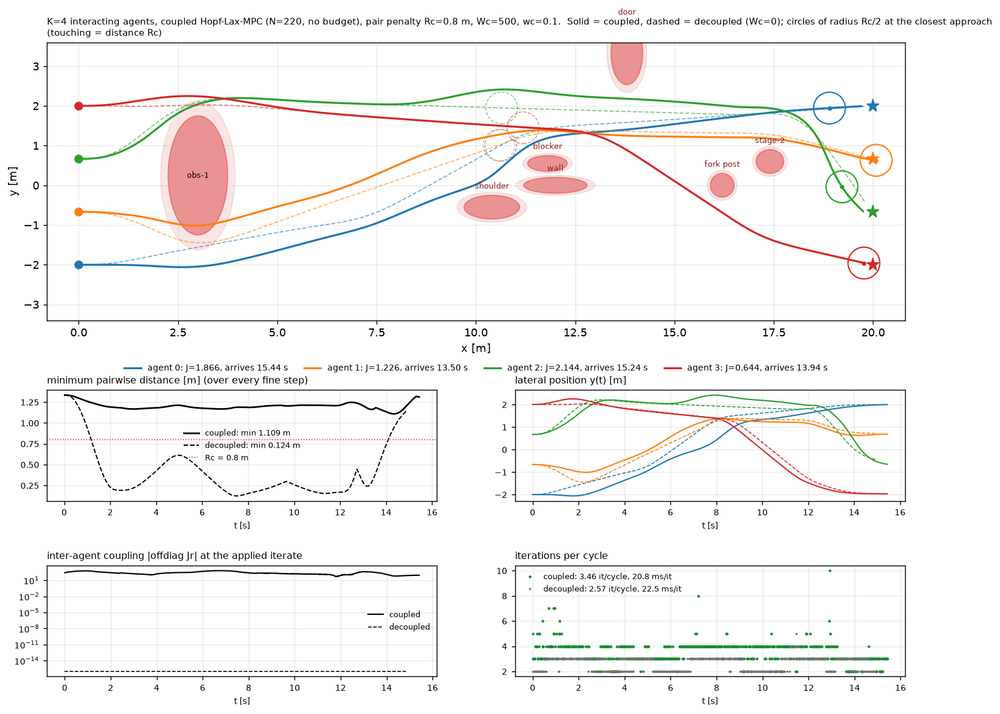
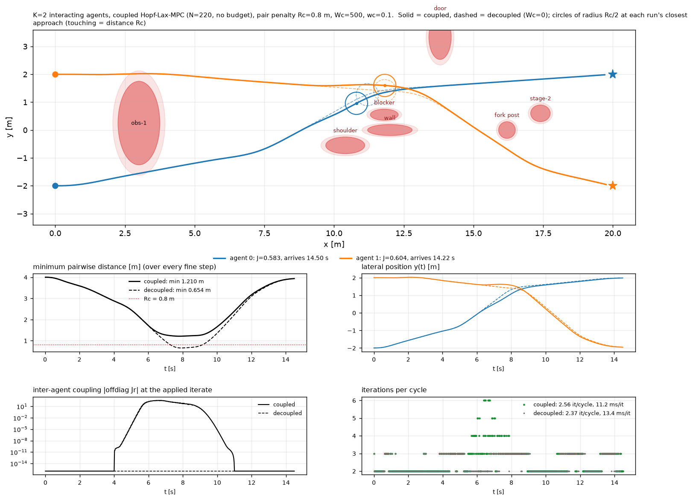
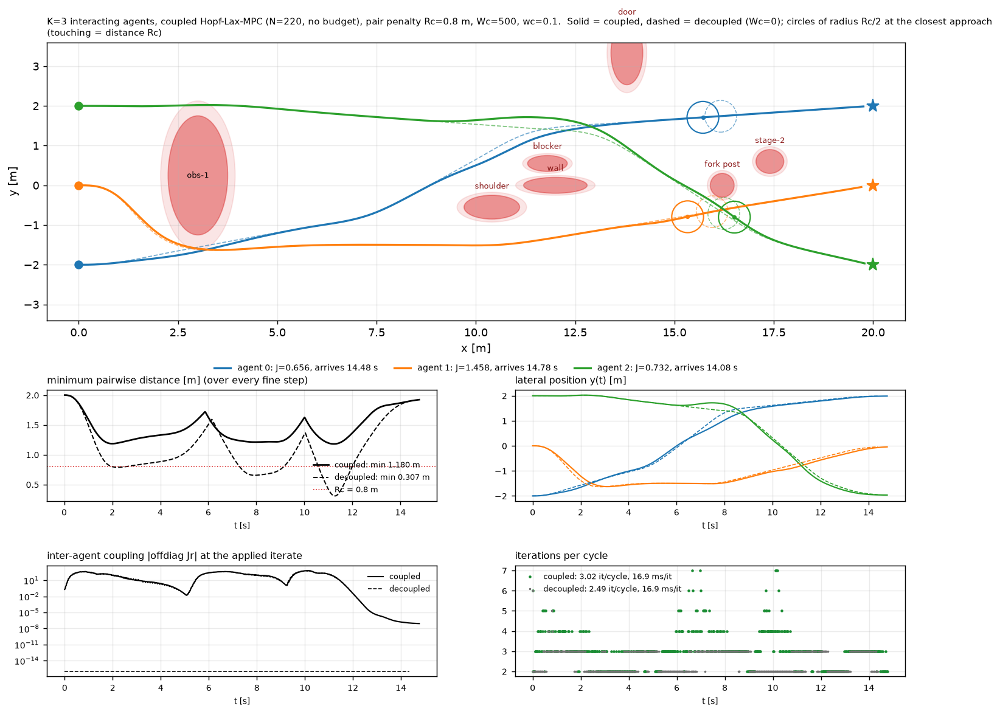
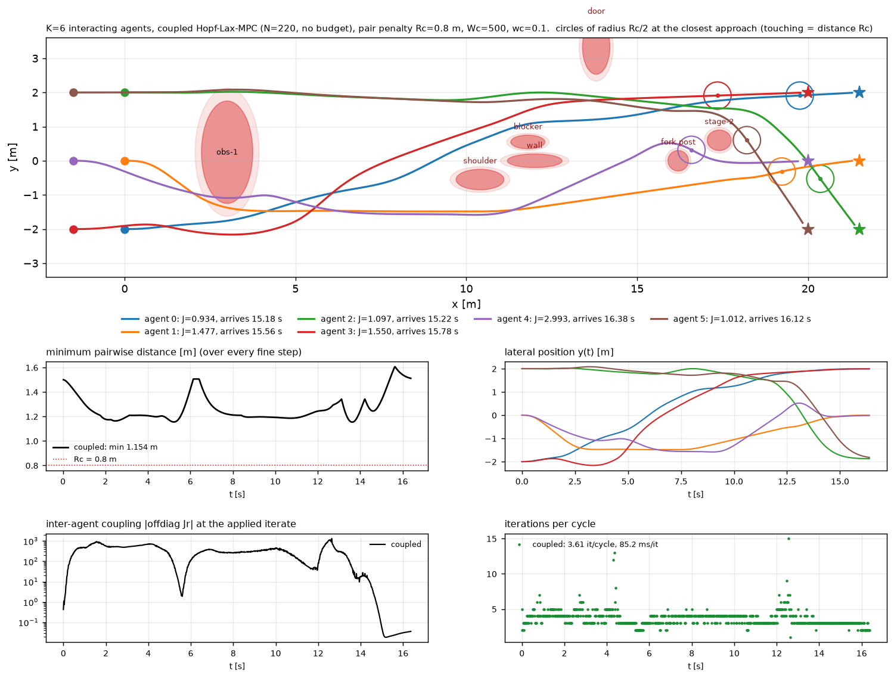
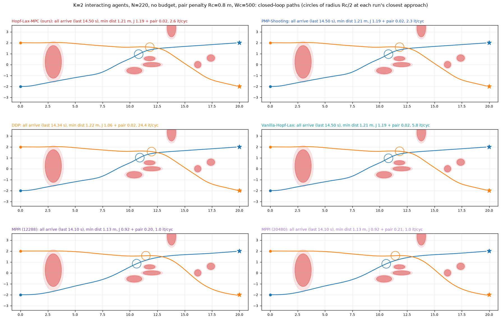
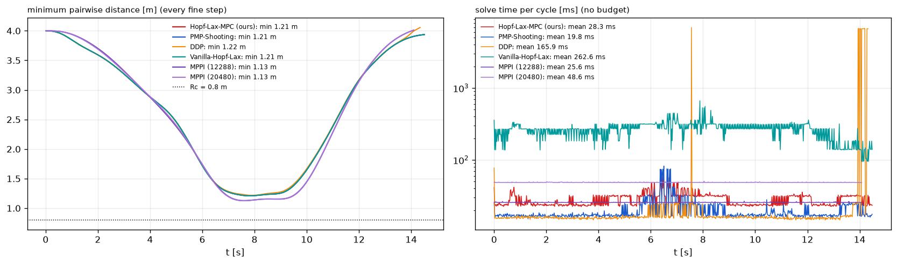

# Interacting agents: Hopf–Lax-MPC with pairwise collision avoidance

Extension of [`../multi_agent`](../multi_agent/README.md). The K agents there are decoupled. In the
recorded decoupled runs, pairs come within 0.65 m (K = 2), 0.31 m (K = 3), 0.12 m (K = 4) and 0.01 m
(K = 10).

Here the running cost gets a soft **pairwise collision penalty**. This couples the agents through the
costate equation, so the K rollouts become one joint rollout and the Jacobians become dense. The
algorithm (`core/mpc_solvers.hopf_lax_mpc_solve`) is still run **unchanged**. The solver object works
for any number of agents; K = 2–6 are tested (K ≥ 5 with a column layout, section 5.1).



Contents

1. [Files](#1-files)
2. [Coupled problem: cost, Hamiltonian, canonical system](#2-coupled-problem-cost-hamiltonian-canonical-system)
3. [Implementation](#3-implementation)
4. [Correctness checks](#4-correctness-checks)
5. [Results](#5-results)
6. [Remarks and limitations](#6-remarks-and-limitations)
7. [Reproducing](#7-reproducing)

---

## 1. Files

| file | role |
|---|---|
| [`mpc_multi_int.py`](mpc_multi_int.py) | the pair penalty (`pair_penalty`, NumPy twin `pair_penalty_np`, `pair_distances`), the **coupled shooting object** `build_ss_int` (same API as `build_ss_multi`), the closed-loop step with the true pair cost `apply_step_int` |
| [`mpc_testbed_multi_int.py`](mpc_testbed_multi_int.py) | driver: closed loop for one K (`run_int`), results table, self-test (`--selftest`), CLI |
| [`plot_multi_int.py`](plot_multi_int.py) | `figs/K<K>_Rc<Rc>_Wc<Wc>/compare.png` (coupled vs decoupled) and the printed table |
| [`make_animation_multi_int.py`](make_animation_multi_int.py) | top-down animation with safety discs and minimum-distance HUD → `figs/K<K>_…/anim.mp4`; 3-D animation with the closest pair marked (`--three-d`) → `anim3d.mp4` (not versioned) |
| [`readme_to_html.py`](readme_to_html.py) | renders this README as the self-contained `README.html` (MathJax, embedded figures, contents tree), reusing `../multi_agent/readme_to_html.py` |
| [`results_multi_int_table.txt`](results_multi_int_table.txt) | the recorded results table |
| `results_multi_int.pkl` | per-cycle data (not versioned; regenerate with section 7) |

Reused unchanged:
- **From `../multi_agent`:** the scene, agent layout, references and per-agent `u*` from `mpc_multi.py`,
  `make_env` from `mpc_testbed_multi.py`, and the drawing helpers from `plot_multi.py`.
- **From `../core`:** the model, the single-agent canonical RHS `fz_aug` and `fz_track`, and the solver.

---

## 2. Coupled problem: cost, Hamiltonian, canonical system

The notation is that of `../multi_agent/README.md` sections 2–5: agent k has state
$x_k\in\mathbb R^7$, position $q_k = [p_x,p_y,p_z]_k$, costate $p_k$, single-agent running cost
$L_k$ (tracking, control and obstacle barriers), terminal cost $\phi_k$ and dynamics $f$ (`dyn7`).

**Pair penalty.** For a safety radius $R_c$, weight $W_c$ and shell width $w_c$, in the same tanh family
as the obstacle barriers:

$$
r_{ij} = \sqrt{\frac{\|q_i-q_j\|^2}{R_c^2}+\varepsilon},\qquad
z_{ij} = \frac{r_{ij}-1}{w_c},\qquad
C(q_i,q_j) = \frac{W_c}{2}\big(1-\tanh z_{ij}\big).
$$

Its gradient is

$$
g_{ij} := \nabla_{q_i} C(q_i,q_j) = -\frac{W_c}{2w_c}\big(1-\tanh^2 z_{ij}\big)\frac{q_i-q_j}{R_c^2\,r_{ij}},
\qquad \nabla_{q_j} C(q_i,q_j) = -g_{ij}.
$$

$C$ is symmetric, and its gradient is antisymmetric: $g_{ji} = -g_{ij}$. The defaults are
$R_c = 0.8$ m, $W_c = 500$, $w_c = 0.1$ and $\varepsilon = 10^{-10}$.

**Coupled running cost and Hamiltonian.**

$$
L(\mathbf x,\mathbf u,t) = \sum_{k=1}^K L_k(x_k,u_k,t) + \sum_{i<j} C(q_i,q_j),
\qquad
H(\mathbf x,\mathbf p,\mathbf u,t) = \sum_{k=1}^K \Big[L_k(x_k,u_k,t) + p_k^\top f(x_k,u_k)\Big] + \sum_{i<j} C(q_i,q_j).
$$

**Optimal control is unchanged.** $C$ does not depend on $\mathbf u$, so
$\partial H/\partial u_k = 2Ru_k + [p_{k,5},p_{k,6},p_{k,7}]^\top$. Each agent therefore keeps the
clipped single-agent minimiser $u_k^\star(x_k,p_k)$. The dynamics stay decoupled.

**Costate equation: the only new term.**

$$
\dot p_k = -\frac{\partial H}{\partial x_k}
= -\underbrace{\Big(2Q(x_k-x_{r,k}) + \big[\nabla B_s + \nabla B_m;\,0_4\big] + h(x_k,p_k)\Big)}_{\texttt{dHdx7}(x_k,\,p_k)}
\;-\;\Big[\textstyle\sum_{j\ne k} g_{kj}\,;\ 0_4\Big].
$$

The coupling enters only through the three position entries of each costate. Every agent's costate
is pushed by the others' positions, so the canonical system of all K agents must be integrated
**jointly**.

**Objective, residual, derivatives.** The objective is
$\boldsymbol\Phi(\mathbf v) = \int_0^T L\,dt + \sum_k\phi_k(x_k(T))$, which includes the integrated pair
penalty. There is no terminal coupling, so the transversality residual keeps its per-agent form:

$$
\rho_k = p_k(T) - 2Q_T\big(x_k(T)-x_{r,k}(T)\big).
$$

The gradient and the curvature surrogate keep their form,
$\nabla\boldsymbol\Phi = -\mathbf S_x^\top\boldsymbol\rho$ and
$\mathbf M = \mathrm{sym}(-\mathbf S_x^\top\mathbf J_r)$. Now, however,
$\mathbf J_r = \partial\boldsymbol\rho/\partial\mathbf v$ and $\mathbf S_x$ have **nonzero off-diagonal
blocks** $\partial\rho_i/\partial v_j$ whenever agents i and j interact within the horizon. They are not
block-diagonal any more. These are the dense $7K\times7K$ matrices the unchanged algorithm already
forms in the decoupled case.

**Per-iteration cost.**
- **RHS evaluation:** each evaluation costs $\mathcal O(K)$ for the agent terms and $\mathcal O(K^2)$
  for the pair terms.
- **Sensitivities:** with the 7K tangent directions, the sensitivities cost
  $\mathcal O(NK^2 + NK^3)$. The cubic part has a small constant (a 3-vector per pair).
- **Dense algebra:** $\mathcal O(K^3)$, as before.

---

## 3. Implementation

`mpc_multi_int.build_ss_int(M, K, N, dt, JX, col, napply)`:

- **Joint rollout.** One `lax.scan` carries $Z_A\in\mathbb R^{K\times(2\cdot7+1)}$: per agent
  $[x_k, p_k, c_k]$, with $c_k = \int L_k$ exactly as in the decoupled object, plus a scalar
  $c_p = \int\sum_{i<j}C$.
  - **Agent terms:** the RHS is `jax.vmap(JX.fz_aug)` over agents, i.e. the core's per-agent dynamics,
    $-\partial H/\partial x$ and $L_k$, unchanged.
  - **Coupling:** the position entries of $\dot p_k$ get $-G_k$, with $G_k = \sum_{j\ne k}g_{kj}$, and
    $\dot c_p = \sum_{i<j}C$.
  - **Integration:** RK4 with the same sub-stage reference sampling as the core, so
    $\Phi = \sum_k(c_k+\phi_k) + c_p$.
- **Pair penalty** (`pair_penalty`). It is vectorised over the $K\times K$ difference tensor with the
  diagonal masked out, which works for any K and gives exactly 0 for K = 1. ε keeps the masked
  diagonal square root differentiable.
- **API.** The interface is identical to `build_ss_multi`: `res, J, all, Jr, Sx, g, resx, roll_pred,
  roll_costate, warm`, with flat agent-major 7K vectors and $X_r\in\mathbb R^{K\times(7+3n_m)\times(2N+1)}$.
  So `hopf_lax_mpc_solve` and `ensure_jbatch` run on it unchanged. `roll_pred` and `roll_costate`
  (the warm start) are joint rollouts too.
- **Self-test helpers.** `hamiltonian` (the joint H) and `costate_rhs` (the joint $\dot{\mathbf p}$).

**Closed loop** (`apply_step_int`).
- The plants are integrated per agent, as before.
- Each agent accrues tracking and obstacle cost until its own arrival.
- Each pair accrues the true collision penalty while at least one of its two agents is still active.
- The minimum pairwise distance is recorded over **every** fine RK4 step.
- Arrived agents stay in the problem: they keep flying and remain obstacles for the others.

---

## 4. Correctness checks

`python mpc_testbed_multi_int.py --selftest` (all passed):

| # | check | result |
|---|---|---|
| 1 | **Exact reductions** to `../multi_agent` `build_ss_multi`: $W_c=0$ with K = 2, 3, and K = 1 with the penalty on. Compared: ρ, Φ, $J_r$, $S_x$, `roll_costate`, `roll_pred`, and the solved costate with its iteration count | all **bitwise identical** |
| 2 | Analytic pair gradient $G$ vs `jax.grad` of $\sum_{i<j}C$, K = 2, 3, 5 (pairs inside and outside $R_c$); JAX vs NumPy penalty | rel. diff ≤ 4.4e-16; ≤ 5.7e-14 |
| 3 | **Hand-derived costate equation** (section 2) vs $-\nabla_x$ of the joint Hamiltonian with u held at u*, K = 2 and 4, agents clustered (minimum distance 0.04–0.42 m) | rel. diff ≤ 1.6e-16 |
| 4 | Gradient identity $-\mathbf S_x^\top\boldsymbol\rho$ vs `jax.grad(Φ)` with active coupling, K = 2, 3 | rel. diff 1.8e-9 … 5.7e-7 (RK4 discretisation, as in the single-agent case) |
| 5 | Permutation equivariance, K = 3: permuting agents permutes ρ and $x(T)$ and leaves Φ unchanged | ≤ 5.7e-14 / identical |
| 6 | Coupling is real, K = 2: off-diagonal $J_r$ blocks with agents 4 m apart vs 0.5 m apart | 0 vs 1.3e2 |
| 7 | Column layout: identical to `../multi_agent` for K ≤ 4; every start pair and goal pair ≥ 4/3 m apart for K = 1–10 | all OK |

**Closed-loop reduction.** `--nocol` runs the coupled code with $W_c = 0$, and it reproduces the
recorded decoupled runs of `../multi_agent`:

| K | sum of costs | minimum distance | last arrival |
|---|---|---|---|
| 2 | 1.071 | 0.654 m | 14.34 s |
| 3 | 2.456 | 0.307 m | 14.38 s |
| 4 | 3.216 | 0.124 m | 14.92 s |

---

## 5. Results

Existing obstacle course, N = 220, no budget, iteration cap 1000. The coupled runs use $R_c = 0.8$ m,
$W_c = 500$, $w_c = 0.1$. Full table: [`results_multi_int_table.txt`](results_multi_int_table.txt).

| run | min distance | sum of agent costs | pair cost | last arrival | it/cycle (max) | converged | ms/iter |
|---|---|---|---|---|---|---|---|
| K=2 decoupled | 0.654 m | 1.071 | – | 14.34 s | 2.37 (3) | 100 % | 13.4 |
| **K=2 coupled** | **1.210 m** | 1.187 | 0.024 | 14.50 s | 2.56 (6) | 100 % | 11.2 |
| K=3 decoupled | 0.307 m | 2.456 | – | 14.38 s | 2.49 (5) | 100 % | 16.9 |
| **K=3 coupled** | **1.180 m** | 2.846 | 0.082 | 14.78 s | 3.02 (7) | 100 % | 16.9 |
| K=4 decoupled | 0.124 m | 3.216 | – | 14.92 s | 2.57 (5) | 100 % | 22.5 |
| **K=4 coupled** | **1.109 m** | 5.879 | 0.696 | 15.44 s | 3.46 (10) | 100 % | 20.8 |

Findings:

- **The coupling works.** With the penalty, every pair stays above $R_c$ for the whole run, at
  1.11–1.21 m minimum distance. The decoupled runs reach 0.65 / 0.31 / 0.12 m. All agents still reach
  their goals, 0.2–0.5 s later.
- **Price of separation.** The tracking and obstacle cost rises by 11 %, 16 % and 83 % for K = 2, 3, 4.
  The pair cost itself stays small, because the agents keep the penalty mostly inactive: the closed
  loop anticipates encounters over the 1.1 s horizon rather than pushing through the barrier. For
  K = 4 the paths are reshaped along the whole course, not only at the encounters (figure above).
- **Solver.** Every cycle of every run converged, with the certified stop of section 4 of the
  multi-agent README. The iteration count grows modestly (2.6 → 3.5 per cycle at K = 4). The saddle
  escape fired twice, at K = 4 (2 kicks), which is the expected pass-left-or-right symmetry.
- **Per-iteration cost is unchanged** within timing noise. The joint rollout costs no more than the
  vmapped independent rollouts, because the sensitivities were already formed densely over all 7K
  directions in the decoupled object. The $\mathcal O(K^2)$ pair term is negligible at these K.
  The machine was not idle during these runs: the decoupled K = 2 baseline took 13.4 ms/iter here,
  against 9.7 ms recorded in `../multi_agent`. Treat the timings as indicative only.

Figures: `figs/K<K>_Rc0.8_Wc500/compare.png`, for K = 2, 3, 4. Each shows the map with coupled
(solid) vs decoupled (dashed) paths and safety discs at the closest approach, the minimum pairwise
distance vs time, $y(t)$, the inter-agent Jacobian coupling $\|J_r^{\text{offdiag}}\|$, and the
iterations per cycle.





The K = 4 figure is at the top of this page.

Animations, per K (rendered locally, not versioned; see section 7):

| K | top-down | 3-D |
|---|---|---|
| 2 | [`anim.mp4`](figs/K2_Rc0.8_Wc500/anim.mp4) | [`anim3d.mp4`](figs/K2_Rc0.8_Wc500/anim3d.mp4) |
| 3 | [`anim.mp4`](figs/K3_Rc0.8_Wc500/anim.mp4) | [`anim3d.mp4`](figs/K3_Rc0.8_Wc500/anim3d.mp4) |
| 4 | [`anim.mp4`](figs/K4_Rc0.8_Wc500/anim.mp4) | [`anim3d.mp4`](figs/K4_Rc0.8_Wc500/anim3d.mp4) |

**Apparent obstacle penetration at K = 4 (agent 1).** In the top-down figure, agent 1 (orange) seems
to enter obs-1 near x = 3. It does not. The top-down view draws obs-1 at its widest section, z = 0,
but obs-1 is an ellipsoid centred at z = 0 with vertical half-axis 0.75 m.

| | lowest $r_{\text{obs-1}}$ | max altitude | obs-1 cost of agent 1 |
|---|---|---|---|
| decoupled | 1.44 | 0.67 m | 0.013 |
| coupled | 1.40 (t = 2.42 s, at (3.03, −1.01, **0.84**)) | **0.84 m** | 0.040 |

- **No penetration.** The barrier coordinate $r$ never drops below 1.40. The barrier is at $r = 1$, and
  the light shell drawn in the figures is at $r = 1.25$.
- **What happens instead.** In the decoupled run, agents 0 and 1 pass obs-1 nearly on top of each
  other: 0.19–0.23 m apart at t = 2–2.4 s, both at y ≈ −1.5. In the coupled run, agent 0 keeps to the
  outside (y ≈ −2.0). Agent 1, squeezed between agent 0 and obs-1, moves 0.45 m towards the obstacle
  and climbs 0.2 m. The climb shrinks obs-1's cross-section, so agent 1 can fly over its flank, and it
  increases the 3-D distance to agent 0 (1.18 m).
- **Why the trade is cheap.** The altitude weight $Q_z = 2$ makes a 0.2–0.3 m climb cheap compared
  with the pair penalty.
- **Where to see it.** The 3-D animations show the obstacles at their true height.

### 5.1 More agents: K = 5, 6 with a column layout

**Why the line layout fails beyond K = 4.** The `multi_agent` layout puts all K starts on x = 0, with
spacing 4/(K−1) m, and the goals mirrored on x = 20. With the same $R_c = 0.8$ m:

- **K ≥ 6:** the agents start, and end, inside or at $R_c$ of each other. In those runs (archived in
  `results_multi_int_columns_v1.pkl`), 99.7–99.9 % of the pair cost accrued in the first 2 s.
- **K = 5:** the 1.0 m goal spacing is below the ~1.1 m separation the closed loop keeps.
- **Result:** with this layout only 1–4 of the K agents arrived.

`R_c`, the weights and the solver were left unchanged. Only the placement was changed
(`agent_layout_int`):

- **Columns.** Agents fill columns of at most 4. Column c starts at $x = -1.5c$, with y uniform in
  [−2, 2].
- **Mirrored goal columns.** Column c's goals are at $x = 20 + 1.5\,(n_{\text{col}}-1-c)$, mirrored in
  y. The front start column gets the farthest goal row, so every route spans the same x distance, and
  the front agents clear the near goal row about 1 s before the rear agents arrive there.
- **Spacing.** Every start pair and every goal pair is at least 4/3 m apart, the K = 4 spacing.
- **K ≤ 4.** The layout is exactly the old one, so the K = 2–4 runs above are unchanged.

**Two earlier attempts.**

- **Goals not mirrored, 16 s limit.** A first column layout had goals at $x = 20 + 1.5c$ and the
  original 16 s run limit. The rear agents' routes (23–27 m) did not fit in 16 s, and the rear agents
  then swept through the front agents' goal area just as those agents slowed down to arrive. The pair
  penalty held 1–2 front agents 0.3–0.6 m from their goals.
- **The fix.** The mirrored goal columns, plus a 100 s run limit (`--maxcyc 5000`; a run still ends
  as soon as all agents are at their goals).

| run | min distance | sum of agent costs | pair cost | last arrival | it/cycle (max) | converged | ms/iter |
|---|---|---|---|---|---|---|---|
| **K=5 coupled** | **1.162 m** | 5.003 | 0.332 | 16.16 s | 3.30 (11) | 100 % | 37.8 |
| **K=6 coupled** | **1.154 m** | 9.063 | 0.500 | 16.38 s | 3.61 (15) | 99.4 % | 85.2 |

Both runs succeed: every agent arrives, and no pair comes closer than 1.15 m. No decoupled baselines
were run for this layout.



Animations: [`K5 anim.mp4`](figs/K5_Rc0.8_Wc500/anim.mp4),
[`K5 anim3d.mp4`](figs/K5_Rc0.8_Wc500/anim3d.mp4), [`K6 anim.mp4`](figs/K6_Rc0.8_Wc500/anim.mp4),
[`K6 anim3d.mp4`](figs/K6_Rc0.8_Wc500/anim3d.mp4). The K = 5 figure is
`figs/K5_Rc0.8_Wc500/compare.png`.

**K ≥ 7: not completed.** The K = 7 run was stopped at t = 38 s of simulated time (cycle 1900), so it
was not saved.

- **What happened.** All seven agents were within about 0.4 m of their goals. Agents 1 and 2 hovered
  about 0.4 m from goals that are only 4/3 m apart, while the pair penalty kept them about 1.15 m apart.
- **Why it doesn't end.** Both cannot be inside the 0.3 m reach tolerance at the same time, and a run
  ends only when every agent is at its goal simultaneously.
- **Not run.** K = 8–10.

### 5.2 Baselines on the coupled problem (K = 2)

The five baselines of the single-agent study run on the same coupled problem: stacked dynamics and the
cost $\sum_k L_k + \sum_{i<j} C$. Files: [`mpc_baselines_int.py`](mpc_baselines_int.py) (solvers),
[`mpc_testbed_baselines_int.py`](mpc_testbed_baselines_int.py) (closed loop and self-test), and
[`plot_baselines_int.py`](plot_baselines_int.py) (figures and table).

| baseline | multi-agent extension |
|---|---|
| PMP-Shooting | LM on $\boldsymbol\rho(\mathbf v) = 0$ (`pmp_shooting_solve`, counted N-sweep copy). It uses only $\boldsymbol\rho$ and $\mathbf J_r$ of the shooting object, so it runs **unchanged** on the coupled `build_ss_int` (section 3). |
| Vanilla-Hopf–Lax | Damped Newton on $\boldsymbol\Phi$ with the exact Hessian (`vanilla_hopf_lax_solve`, tol 1e-4). It runs unchanged on `build_ss_int`; the Hessian is the $7K\times7K$ `jax.hessian` of the coupled $\boldsymbol\Phi$. |
| DDP | `build_ddp_int`, a copy of `build_ddp` on the joint model (details below). The counted `ddp_run` runs unchanged. |
| MPPI (12288 / 20480 samples) | `MPPIInt`, a subclass of `MPPI` with a new CUDA kernel: one thread rolls out all K agents of one sample and adds the pair term. λ tuning, update, Savitzky–Golay filter and warm start are inherited; the control dimension is 3K. |

**DDP on the joint model.**
- **Dynamics:** state $\mathbf x\in\mathbb R^{7K}$, control $\mathbf u\in\mathbb R^{3K}$, and
  $F(\mathbf x,\mathbf u) = [\mathrm{RK4}(x_1,u_1);\dots;\mathrm{RK4}(x_K,u_K)]$.
- **Stage cost:** $(\mathbf x-\mathbf x_r)^\top Q_{\text{blk}}(\mathbf x-\mathbf x_r) + \mathbf u^\top R_{\text{blk}}\mathbf u + B(\mathbf q)$,
  with $B(\mathbf q) = \sum_k B_{\text{obs}}(q_k) + \sum_{i<j} C(q_i,q_j)$.
- **Gradient of $B$:** analytic (the obstacle gradients plus $G_k$ of section 2).
- **Hessian of $B$:** taken over all $3K$ positions and PSD-projected, as the original projects the
  per-agent $3\times3$ barrier Hessian.
- **Dynamics Hessians:** $F_{xx}, F_{uu}, F_{ux}$ of the joint $F$, formed densely (the honest
  "stack and run", like Hopf–Lax-MPC's dense Jacobians).
- **Not used:** the single-agent `DDP_YSHIFT` nudge of the moving-wall testbed, since the scene here is
  frozen.

**Self-test** (`python mpc_testbed_baselines_int.py --selftest`, all passed):

| check | result |
|---|---|
| DDP, K = 1 vs the single-agent `build_ddp`: rollout, cost, backward gains and $dV$, `costate0`, and the full `ddp_run` | identical (same p0, same 5 iterations) |
| DDP, K = 2, $W_c = 0$: gains are block-diagonal and equal the two solo backward passes; off-diagonal blocks exactly 0 | ≤ 3.4e-15 |
| DDP, K = 2, coupled: analytic $\nabla B$ vs `jax.grad`; `costate0` vs $\partial J/\partial \mathbf x_0$ by autodiff | 1.3e-16 / 8.1e-16 |
| DDP, K = 2, at the Hopf–Lax-MPC closest approach (1.21 m): off-diagonal feedback gains | 29 (exactly 0 with $W_c = 0$) |
| MPPI kernel, K = 1 vs the single-agent kernel, same noise | identical |
| MPPI kernel, K = 2 ($W_c$ = 500 and 0) vs a NumPy reference of the joint sample cost | ≤ 2.1e-15 |
| PMP and Vanilla at the Hopf–Lax-MPC closest approach, warm-started at its solution | both accept it in 0 iterations |
| PMP and Vanilla from $p = 0$ at the same state (information only) | both converge to the Hopf–Lax-MPC point (‖Δp‖ 1.9e-6 / 2.7e-5) |

**Closed loop, K = 2** (N = 220, no budget, cap 1000; table
[`results_baselines_int_K2_table.txt`](results_baselines_int_K2_table.txt)):

| method | arrive | last arrival | min distance | sum of costs | pair cost | it/cycle (max) | converged | solve ms (mean) | ms/iter |
|---|---|---|---|---|---|---|---|---|---|
| Hopf–Lax-MPC | all | 14.50 s | 1.210 m | 1.187 | 0.024 | 2.56 (6) | 100 % | 28.3 | 11.2 |
| PMP-Shooting | all | 14.50 s | 1.210 m | 1.187 | 0.024 | 2.35 (9) | 100 % | 19.8 | 8.4 |
| DDP | all | 14.34 s | 1.217 m | 1.056 | 0.018 | 24.4 (1000) | 97.8 % | 166 | 7.9 |
| Vanilla-Hopf–Lax | all | 14.50 s | 1.210 m | 1.187 | 0.024 | 5.80 (15) | 100 % | 263 | 45.4 |
| MPPI (12288) | all | 14.10 s | 1.128 m | 0.925 | 0.202 | 1 | – | 25.6 | 25.6 |
| MPPI (20480) | all | 14.10 s | 1.127 m | 0.924 | 0.208 | 1 | – | 48.6 | 48.6 |





Findings:

- **Every method solves K = 2.** Both agents arrive, and no pair comes closer than 1.13 m.
- **PMP and Vanilla follow Hopf–Lax-MPC exactly.** Their maximum state deviation from it is
  2.6e-6 m (PMP) and 9.4e-4 m (Vanilla). At K = 2 the closed loop never meets a saddle, so all three
  converge to the same stationary points.
- **Vanilla is slower per iteration.** Its exact $14\times14$ Hessian makes an iteration cost 4×
  that of Hopf–Lax-MPC (45 vs 11 ms).
- **DDP takes a different local solution, with a lower cost (1.056).** It needs a mean of 24
  iterations per cycle. In 16 of 717 cycles it crawls into the 1000-iteration cap and is counted as
  stalled; these are at t = 7.56 s and t = 13.9–14.3 s, when agent 1 is at its goal. Its slowest cycle
  takes 6.9 s.
- **MPPI arrives earliest and has the lowest tracking cost (0.92).** It keeps less separation
  (1.13 m), so its pair cost is 10× higher.
- **Timing caveat.** The Hopf–Lax-MPC row comes from the earlier run in section 5, on a machine that
  was not idle (section 6).

---

## 6. Remarks and limitations

- **Goal spacing vs $R_c$.** The closed loop keeps neighbours about 1.1–1.2 m apart with
  $R_c = 0.8$ m. Goals closer than that cannot all be reached at once:
  - the line layout for K ≥ 5;
  - the 4/3 m column spacing, which is reachable for K = 4–6 but led to the K = 7 standoff.
  Larger K needs either wider goal spacing or a smaller $R_c$ (`--Rc`).
- **Soft, not hard.** The penalty is a cost, not a constraint. Separation is not guaranteed; it is
  traded against tracking through $W_c$ and $w_c$.
- **Timing hygiene.** The scaling numbers of `../multi_agent` were taken on an idle machine. The runs
  here were not (see section 5), so compare ms/iter only within this table.

---

## 7. Reproducing

From this folder, with the `HopfLaxMPC` environment (on Windows set `PYTHONNOUSERSITE=1`, see the
repository README).

```powershell
python mpc_testbed_multi_int.py --selftest                 # section 4
python mpc_testbed_multi_int.py --K 2,3,4 --nocol           # decoupled baselines (Wc = 0)
python mpc_testbed_multi_int.py --K 2,3,4                   # coupled (Rc 0.8, Wc 500, wc 0.1)
python mpc_testbed_multi_int.py --K 5,6 --maxcyc 5000       # coupled, column layout, 100 s limit
python plot_multi_int.py > results_multi_int_table.txt      # figs/K*_Rc0.8_Wc500/compare.png + table
python make_animation_multi_int.py --K 4                    # figs/K4_Rc0.8_Wc500/anim.mp4   (likewise --K 2, 3, 5, 6)
python make_animation_multi_int.py --K 4 --three-d          # figs/K4_Rc0.8_Wc500/anim3d.mp4 (likewise --K 2, 3, 5, 6)
python mpc_testbed_baselines_int.py --selftest             # section 5.2 baseline checks
python mpc_testbed_baselines_int.py --K 2                  # PMP, DDP, Vanilla, MPPI 12288 / 20480 (coupled)
python plot_baselines_int.py --K 2 > results_baselines_int_K2_table.txt   # figs/baselines/K2/
python readme_to_html.py                                    # README.md -> README.html
```

Options of `mpc_testbed_multi_int.py`:
- `--K` (comma list), `--N` (default 220)
- `--Rc`, `--Wc`, `--wc` (penalty), `--nocol`
- `--maxcyc`, `--cap`, `--out`, `--redo`, `--print-every`

Results merge into the pickle under the key (K, N, Rc, Wc, wc).
